# ROV Telemetry Ground Station

A native desktop application (C++17 / Qt 6 / QML) that simulates a small
underwater vehicle and lets an operator monitor and control it.

Submitted for the Coratia Technologies software internship technical assessment.

---

## At a glance

- Native Qt 6 / QML, no browser / no web view.
- Vehicle simulator is a pure C++17 static library that **does not link Qt**
  and is driven by a 116-check headless test suite.
- Fixed 50 Hz physics (thruster lag, quadratic drag, buoyancy, attitude,
  battery), decoupled from the UI frame rate.
- Three flight modes (Manual, Depth Hold, Heading Hold) sharing one small PID
  class with clamping anti-windup and derivative-on-measurement.
- Dashboard with artificial horizon ADI, compass/HSI, four signed thrust bars,
  live depth and heading plots, embedded OpenStreetMap, CSV mission logging,
  injectable ocean current, and a one-second Manual dead-man timer.
- One keyboard driver (WASD / QE / RF / Space / 1-2-3) wired through a
  C++-level event filter, so focus never gets in the way.

---

## Build and run

### Requirements

- CMake 3.21+
- A C++17 compiler
- Qt 6.5 or newer, with these modules:
  `Core`, `Gui`, `Qml`, `Quick`, `QuickControls2`, `Location`, `Positioning`

On macOS the single Homebrew `qt` formula includes all of them:

```bash
brew install qt cmake
```

### Build

```bash
cmake -B build -DCMAKE_BUILD_TYPE=Release -DCMAKE_PREFIX_PATH="$(brew --prefix qt)"
cmake --build build -j
```

### Run

```bash
# macOS
./build/bin/rov_ground_station.app/Contents/MacOS/rov_ground_station

# Linux
./build/bin/rov_ground_station
```

### Test

All simulation and controller tests run headlessly, without Qt:

```bash
ctest --test-dir build --output-on-failure
```

The suite also builds standalone with nothing but a C++ compiler:

```bash
g++ -std=c++17 -I src/sim \
    src/sim/Simulator.cpp src/sim/CsvLogger.cpp tests/test_simulator.cpp \
    -o /tmp/t && /tmp/t
```

---

## Flying the vehicle

Keyboard (all modes except where noted):

| Key    | Action                           |
|--------|----------------------------------|
| W / S  | Forward / back                   |
| A / D  | Strafe left / right              |
| Q / E  | Yaw left / right                 |
| R / F  | Rise / dive                      |
| Space  | Arm / disarm                     |
| 1 / 2 / 3 | Manual / Depth Hold / Heading Hold |

Target depth and target heading are set through the spin boxes in **Flight
Control**. In Depth Hold the vertical axis is closed-loop; in Heading Hold the
yaw axis is. The operator retains manual authority over the other axes in all
modes.

The **dead-man** indicator in the footer shows how long it has been since the
last operator input. After one second with no input, Manual thrust decays to
zero through the normal actuator lag. **Space** or the big ARM button toggles
armed state immediately — disarm forces thrust to zero in the same tick.

---

## Architecture

The single design decision everything else follows from:
**the simulator does not know the GUI exists.**

```
src/sim/      rovsim — static library, pure C++17, links no Qt at all
  VehicleState.h           state struct + Mode enum + ControlInput
  Simulator.h/.cpp         50 Hz fixed-step integrator, safety interlocks
  Pid.h                    PID with clamping anti-windup, D-on-measurement
  CsvLogger.h/.cpp         mission logger, <fstream> only

src/app/      rov_ground_station — Qt6/QML executable
  RovController.h/.cpp     ONE class that knows both sides;
                           exposes the simulator to QML as a singleton,
                           owns the 50 Hz tick timer, filters keyboard
                           events application-wide
  main.cpp                 engine bootstrap
  qml/Main.qml             dashboard, ADI, compass, plots, map

tests/        test_simulator — headless, links rovsim only (116 checks)
```

### Where safety lives

The arm/disarm interlock and the Manual dead-man timer are enforced **inside
the simulator**, in `Simulator::integrate()`. Not in the UI. A bug in the
dashboard, a stuck key, or a future MAVLink control source cannot route
around them. `Simulator::setArmed(false)` also zeroes thrust immediately
without waiting for the next tick.

### Fixed-step physics, late-frame tolerant

`Simulator::step(dt)` sub-steps internally at `kFixedStep = 0.02 s`
(50 Hz) and carries the remainder across calls. The driver passes wall-clock
elapsed time, not the nominal timer interval, so Qt timer jitter and late
frames are absorbed rather than silently lost. A pathological `dt` (debugger
breakpoint, machine sleep) is clamped so the integrator can never blow up.

### Threading

Physics ticks on the GUI thread via `QTimer` at 50 Hz. The physics costs
microseconds per tick; a background thread would buy complexity without
buying responsiveness. The clean seam is there if real work ever appears —
move the simulator onto a `QThread` and queue-connect the setters; no QML
changes.

### Keyboard focus

Keyboard input is intercepted by `RovController::eventFilter`, installed at
the `QCoreApplication` level. It fires before any QML widget sees the keys,
except when the currently focused object is a text widget (a SpinBox editor)
— in which case the filter steps aside so you can type. The consequence:
WASD/RF work from the moment the window opens, and after editing any
SpinBox, without ever needing to click back on the dashboard first.

---

## Workflow

The high-level flow of control, data, and the hard boundary between Qt-free
physics and Qt UI.

```mermaid
flowchart LR
    %% ---- Inputs ----
    KB[Keyboard<br/>WASD · QE · RF · Space · 1/2/3]
    UI[Dashboard<br/>buttons · spinboxes]

    %% ---- Qt/App layer ----
    subgraph APP["Qt / App layer"]
        direction TB
        EF[eventFilter<br/>app-wide]
        RC[RovController<br/>QML singleton]
        TIMER[QTimer @ 50 Hz]
        LOG[CsvLogger<br/>10 Hz rows]
    end

    %% ---- Pure C++ sim ----
    subgraph SIM["Simulation core &#40;no Qt&#41;"]
        direction TB
        INPUT[Operator demand<br/>+ Mode]
        INTERLOCK[Safety interlocks<br/>disarm = 0 thrust<br/>dead-man timeout]
        HOLD{Hold-mode<br/>controllers}
        DEPTH_PID[Depth Hold PID<br/>D on measurement<br/>anti-windup]
        HEAD_PID[Heading Hold PID<br/>wraps 359->1]
        LAG[Thruster lag<br/>1st-order exp]
        PHYS[Dynamics<br/>drag · buoyancy<br/>attitude · battery<br/>+ ocean current]
        STATE[(VehicleState)]
    end

    %% ---- Dashboard outputs ----
    subgraph VIEW["Dashboard &#40;QML&#41;"]
        direction TB
        ADI[Artificial horizon<br/>+ compass]
        CHARTS[Depth and Heading<br/>plots &#40;Canvas&#41;]
        MAP[OSM map<br/>+ track + current arrow]
        TELEM[Numeric fields<br/>thrust bars · battery]
    end

    %% ---- Edges ----
    KB --> EF --> RC
    UI --> RC
    RC --> INPUT
    TIMER --> RC
    RC --> INTERLOCK
    INTERLOCK --> HOLD
    HOLD -- "Depth Hold" --> DEPTH_PID --> LAG
    HOLD -- "Heading Hold" --> HEAD_PID --> LAG
    HOLD -- "Manual" --> LAG
    LAG --> PHYS --> STATE
    STATE -. telemetryChanged .-> RC
    RC --> ADI
    RC --> CHARTS
    RC --> MAP
    RC --> TELEM
    RC --> LOG
    LOG --> CSV[["~/rov_YYYYMMDD_HHMMSS.csv"]]

    classDef sim fill:#1b2a35,stroke:#2f9fd6,color:#e6edf3;
    classDef app fill:#232b36,stroke:#7d8f9e,color:#e6edf3;
    classDef view fill:#1e2a1e,stroke:#3fb950,color:#e6edf3;
    classDef io   fill:#2a1a1a,stroke:#f04747,color:#e6edf3;
    class INPUT,INTERLOCK,HOLD,DEPTH_PID,HEAD_PID,LAG,PHYS,STATE sim
    class EF,RC,TIMER,LOG app
    class ADI,CHARTS,MAP,TELEM view
    class KB,UI,CSV io
```



The same picture rendered as SVG lives at `docs/workflow.svg`.

---

## The vehicle model

All tunable numbers live in one struct, `VehicleParams` in `src/sim/Simulator.h`.
Nothing is magic-numbered into the integrator.

**Thruster response.** A first-order lag with a 0.25 s time constant sits
between the operator demand and the force actually produced, so a step
demand reaches 63% after one time constant. Integrated as an exact
exponential (`1 - exp(-dt/tau)`) rather than `(target-current) * dt / tau`,
which makes the response independent of step size and impossible to overshoot.

**Drag.** `linear*v + quadratic*v*|v|` on every axis. The quadratic term sets
terminal velocity; the linear term keeps the model well behaved near zero.
Forward terminal speed works out at 0.97 m/s, and the test suite verifies
analytically that drag at that speed equals maximum thrust force.

**Added mass** is direction-dependent (1.1× surge, 1.4× sway, 1.6× heave) —
a blunt hull entrains more water sideways than forward.

**Buoyancy** is trimmed 1.5 N positive so a disarmed vehicle floats up rather
than being lost. Depth Hold integrates this out.

**Attitude.** Roll and pitch are a damped second-order response to the
forces the thrusters produce: nose-down under forward thrust, nose-down
when diving (vertical thrusters forward of CoG), roll when crabbing. Yaw
is independently actuated.

**Battery.** SOC-linear open-circuit voltage, 30 mΩ pack resistance for
sag. Voltage dips on thrust bursts and recovers when they ease — reproduces
the two things an operator watches for in real voltage.

**Ocean current.** Injectable at runtime. Drag acts on velocity *through
the water*, not on ground track — so a disarmed vehicle drifts with the
current and Depth Hold has to work against a vertical component.

---

## The hold-mode controllers

Both Depth Hold and Heading Hold share one small `Pid` class (`src/sim/Pid.h`).

**D on measurement.** The derivative term uses the measured rate (heave
velocity, yaw rate), not the error derivative. A setpoint jump produces a
pure proportional response instead of a derivative spike that would briefly
saturate the thrusters. A test asserts on this.

**Clamping anti-windup.** The integrator only accumulates when the output
is not already at the stop, or when the error is working to bring the
output back inside its limits. Without this, a long saturated approach
builds integrator value that has to be discharged by overshooting the other
side. A test holds a saturated error for ten seconds, reverses it, and
checks the controller swings to the opposite rail immediately.

**Reset on mode switch.** `Simulator::setMode()` resets both integrators so
the new mode never inherits accumulated error from the previous mode.

**Why Heading Hold is pure PD and Depth Hold has Ki.** Yaw has no
persistent torque disturbance; Ki buys only overshoot. Depth has to fight
positive buoyancy with a small sustained downward thrust; that's Ki's job.

**Compass wrap.** `wrapError180()` normalises raw error into `[-180, 180)`,
so a target of 10° with a measurement of 350° produces +20° (turn the short
way clockwise through north), not -340°.

---

## Plot and map

**Depth-vs-time** and **Heading-vs-time** are JavaScript `Canvas` panels. A
`Timer` samples the simulator at 10 Hz into a 60-second ring buffer and
calls `requestPaint()`. Depth Y is inverted so 0 is at the top. Heading Y
wraps 0–360 with pen-lift at the 359→1 boundary so a northward crossing
reads as a clean break, not a vertical streak. In each hold mode the
target setpoint is a dashed amber line on its own chart.

**OpenStreetMap** is a `QtLocation` `Map` with the built-in `osm` plugin —
native tiles, no web view. A second `Timer` at 2 Hz converts the
simulator's north/east metres into a lat/lon offset (small-angle
approximation) and appends to a `MapPolyline`. The vehicle marker carries a
heading tick that rotates with yaw. When current is non-zero, an amber
arrow at the origin shows the flow direction.

---

## Mission logging

Click **Start Logging** in Flight Control. One CSV row every 100 ms into
`~/rov_YYYYMMDD_HHMMSS.csv` until you click Stop.

The schema is one row per instant with every field a post-mission analyst
would want: raw state, body velocities and rates, actuator outputs,
battery, controller setpoints. Loads straight into pandas or Excel.

---

## AI tool disclosure

Per the assessment rules, AI coding assistance is disclosed.

- **Claude (Anthropic)** was used for: project planning and phase breakdown,
  scaffolding the CMake build, drafting the QML dashboard layout and the
  Canvas-based ADI/compass/plot drawing, reviewing the simulation core, and
  tuning the PID gains against a short Python-free parameter sweep.
- All code was read, understood and adjusted before being committed.
  Illustrative example: the first fixed-timestep accumulator silently
  dropped a tick for any `dt` not exactly divisible by the step size; the
  unit test caught it and the comparison now carries an explicit epsilon.
  The heading PID was first tuned with `Ki = 0.002`; a trajectory sampling
  sweep showed a 13° overshoot and a 60 s unwind, which prompted dropping
  Ki to 0 (no persistent yaw disturbance to integrate out) and bumping Kd.
- The physics model, control strategy and safety design decisions are
  documented above and I am able to explain and modify any part of them.

---

## Test coverage

116 headless checks across the sim, the PID and the CSV logger. Highlights:

- Safety: disarm zeroes thrust in the same tick; dead-man expires at 1 s.
- Fixed-step integrator is step-size-independent and dt-clamped.
- Thrust reaches 63% of demand after one time constant.
- Drag at terminal velocity equals max thrust force (analytic check).
- Surface is a hard floor; disarmed vehicle floats back up.
- Attitude tips under surge thrust AND under heave thrust (dive tip).
- Battery drains at idle, drains faster under load, voltage recovers when
  load drops.
- Depth Hold settles within 30 cm, holds through horizontal motion, and
  compensates a 10 cm/s downward current.
- Heading Hold reaches a 90° step with **zero overshoot**; takes the short
  way around the 350° → 10° wrap.
- Mode switch resets the PID integrators so fresh hold at current state
  does not jerk.
- PID anti-windup: saturated error for 10 s + reversal → opposite rail
  immediately.
- PID D-on-measurement: setpoint step → no derivative kick.
- CSV logger: header, row count, reopen behaviour.
- Hour of full-rate control reversals leaves no NaN / Inf.
